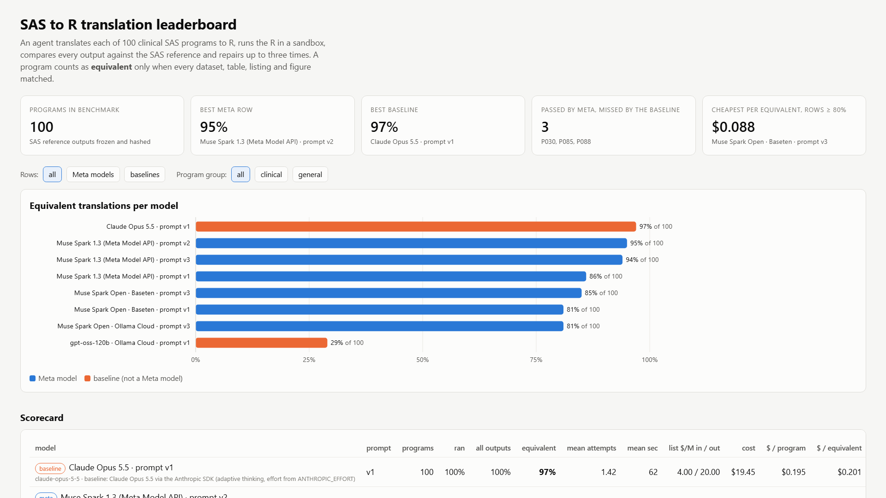
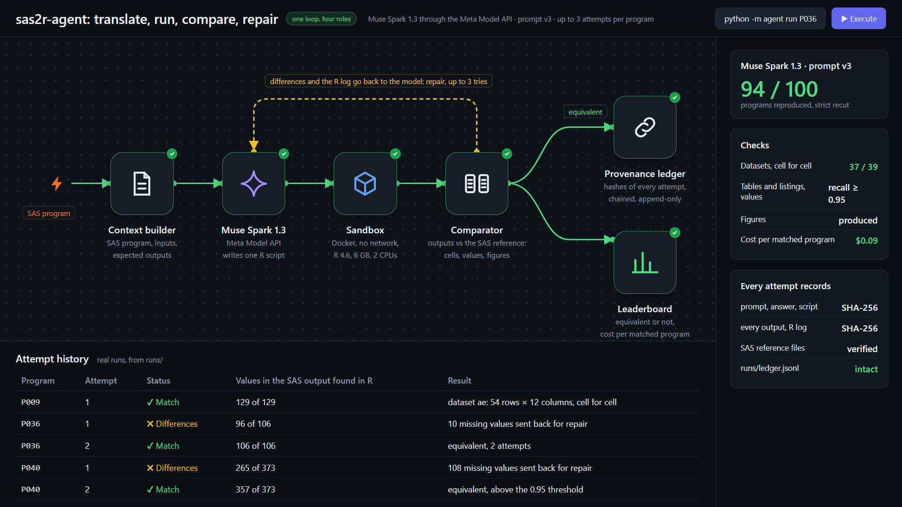

# sas2r-agent

**Muse Spark translates clinical SAS programs to R and shows its work: 94 of 100 benchmark
programs reproduce the SAS output, and every attempt is hashed into an audit ledger.**

Built solo by Thomas Antony, a clinical SAS programmer in pharma since 2008 who has worked in R
since 2016, for the Meta Global AI Developer Hackathon (Indie track, 26 October to
4 November 2026). Demo video: [youtu.be/OiryI10mUdU](https://youtu.be/OiryI10mUdU) (3 minutes). Interactive leaderboard:
`dashboard/index.html` (see [Leaderboard](#leaderboard)).



**Try it in five minutes** (no SAS needed; the reference outputs ship with the benchmark repo):

```
git clone https://github.com/tomasantony/sas2r-agent && git clone https://github.com/tomasantony/sas2r-benchmark
cd sas2r-agent && pip install -r requirements.txt && cp .env.example .env    # add MODEL_API_KEY from dev.meta.ai
docker build -t sas2r-sandbox:r4.6 sandbox/
python -m agent run --provider muse-spark --ids P036     # translate, run, compare, repair; about two minutes
python -m agent leaderboard && python -m http.server 8765 # then open http://localhost:8765/dashboard/
```

The full procedure and every command are under [Running](#running).

## Who this is for

I have programmed SAS in the pharmaceutical industry since 2008 and R since 2016, and
I translate SAS programs to R for clinical trials. Every trial's datasets, tables,
listings and figures are produced by SAS programs, and the industry is moving to R:
Novo Nordisk made the first R-based FDA submission in 2021, Roche the first
end-to-end R submission in 2024, and GSK has trained most of a thousand-person
biostatistics division in R. Each program has to be rewritten and then shown to give
the same result as the SAS original. The showing is the slow part: Merck puts QC
programming at 30 to 50 percent of total programming effort, and double programming
(write it twice, compare the outputs) is the validation method 77 percent of UK trial
units use. In August 2026 the R Consortium reported FDA reviewers asking sponsors for
SAS-equivalent code for analyses submitted in R, and recommended "SAS-to-R
cross-validation" as the evidence to provide.

sas2r-agent produces that evidence automatically. It is for the statistical
programmer who has a SAS program and its outputs and needs an R version checked
against them, with a record a reviewer can inspect. The output is not a signed-off
validation; it is the cross-validation and the audit trail that make sign-off fast.

## What it does

Give it a SAS program and the outputs SAS produced. It writes one R script with Muse
Spark, runs the script in a sandbox, compares every R output with the SAS reference,
and sends the differences back to the model for up to three attempts. Each attempt
leaves a provenance record; a verifier recomputes the whole chain. A 100-program
benchmark and a leaderboard make the result measurable across models and prompt
versions.

## Results

100 public SAS programs (90 clinical, 10 general), reference outputs produced by SAS
9.4, frozen and hashed. "Passed every check" means every output of the program passed
the comparator. The strict columns are the ones to trust: dataset programs are compared
cell by cell at 99.9 percent agreement, and the 14 figure-only programs pass on the
figure being produced, not on pixels, so they are excluded in the third column.

| row | prompt | passed every check, all 100 | dataset programs, cell for cell (39) | excluding figure-only (86) | mean attempts | cost (list) | $ per passed program |
|---|---|---|---|---|---|---|---|
| **Muse Spark 1.3** (Meta Model API, `muse-spark-1.3`) | v3, current | **94** | **37** | **80** | 1.60 | $8.90 | $0.095 |
| Muse Spark 1.3 | v2 | 95 | 38 | 81 | 1.66 | $9.37 | $0.099 |
| Muse Spark 1.3 | v1 | 86 | 33 | 72 | 1.99 | $11.81 | $0.137 |
| **Muse Spark Open** (open weights, Baseten `meta-models/muse-spark-open-1026`) | v3 | 85 | 34 | 71 | 1.82 | $7.49 | $0.088 |
| Muse Spark Open (Ollama Cloud `muse-spark-open`) | v3 | 81 | | | 1.98 | $13.01 | $0.161 |
| baseline: Claude Opus 5.5 | v1 | 97 | 37 | 83 | 1.42 | $19.45 | $0.201 |
| baseline: gpt-oss-120b | v1 | 29 | | | 2.67 | $0.77 | $0.027 |

What that says:

- On the programs with the strictest check, the 39 that produce datasets, Muse Spark
  1.3 matches 37 cell for cell, the same count as Claude Opus 5.5, at half the cost
  per matched program.
- Muse Spark v3 passes three programs Claude misses (P030, P085, P088); Claude passes
  six that v3 misses. The gap between them is inside one sweep's variance (below).
- The open weights score 85 on the same harness, so a sponsor can run the whole
  pipeline on hardware it controls, with patient-level data never leaving its
  firewall. The same weights score 81 on Ollama Cloud, where three programs hit the
  output-token limit before producing code: the serving host is part of the result,
  which is why it is in the row name.
- Cost columns apply each vendor's list price per million tokens to the tokens each
  run used; hackathon credits are not reflected.

`runs/leaderboard.md` has the full table; `dashboard/index.html` the interactive
version with drill-down into every cell.

### What "passed every check" means, and what it does not

| artifact | check | threshold |
|---|---|---|
| dataset (CSV from the R script vs the SAS dataset) | cell by cell after column and row matching, numeric tolerance 1e-6, date normalisation | 99.9% of cells |
| table or listing (text rendering vs the SAS RTF/PDF/LST text) | recall of the numbers printed by SAS, after stripping run stamps and RTF headers | 95% of SAS numbers found |
| figure (PNG vs the SAS image) | the image was produced | presence |

A program passes every check only when every one of its artifacts passes. The comparator
is deliberately strict on datasets and lenient on figures; it does not compare
pixels, does not check numbers the R output contains that SAS does not, and pools
all text files the script wrote when looking for a table's numbers. The agent's own
selftest feeds the SAS reference back through the comparator and must score 1.0 on
every program. None of this replaces a statistician's review; it tells the reviewer
where to look.

### The agent improves from its own failures, and the improvement is measured

Each prompt version is a separate leaderboard row (`run --tag vN`), recorded in every
report and provenance record, so an improvement is measured on the same 100 programs
rather than claimed.

| prompt | passed every check | what changed |
|---|---|---|
| v1 | 86 | initial prompt |
| v2 | 95 | rules distilled from the programs v1 missed and Claude matched (16 before the comparator fix of 29 October, 14 after): strict single-format date parsing, derive missing upstream datasets by CDISC definition, join hygiene, every block a SAS procedure prints by default, PICTURE formats truncate, CLASS marginals, repair discipline |
| v3 | 94 | rules from the five programs v2 missed: PROC IMPORT assigns one date informat per column, a PICTURE worked example, PROC FREQ CHISQ statistics with their formulas, PROC LIFETEST details (standard error of the restricted mean, full covariance matrices) |

v3 fixed all five programs it targeted (P009, P036, P040, P045, P053) and lost six
borderline ones that v2 had passed only on its last repair attempt (P019, P022, P035,
P056, P061, P097). Every program passes under v2 or v3, so one sweep's score carries
a variance of about five programs; cost and attempt counts fall with each version.
The open-weight model went from 81 (v1) to 85 (v3) with the same prompt change. The
rules were derived from this benchmark's own misses with no held-out set; a held-out
set is the first roadmap item.

## How it works



*Diagram of the loop (`docs/demo_flow.html`), not a screenshot of a running app. The attempt rows and the numbers in the side panel are real, taken from `runs/`.*

One loop with four roles, up to three attempts per program:

1. **Context builder** (`agent/context.py`): reads the SAS program, the family
   environment it ran under (librefs, macro variables, included macros, raw
   inputs) and the list of outputs the SAS run produced.
2. **Translator** (`agent/prompts.py`, `agent/llm.py`): asks the model for one
   complete R script that writes every expected output under `OUT_DIR`.
3. **Sandboxed executor** (`agent/runner.py`, `sandbox/Dockerfile`): runs the
   script in a Docker container with no network, a read-only mount of the
   benchmark, a 6 GB memory cap and only the attempt folder writable
   (`SANDBOX=local` falls back to the host `Rscript`).
4. **Comparator and repair** (`agent/compare.py`): compares every artifact as
   described above. When the program does not pass every check, the comparison feedback
   and the R log go back to the model for a repair attempt.

Every attempt writes `provenance.json` (SHA-256 of prompt, answer, reasoning,
script, every output, the R log and the SAS reference files it was compared with,
plus model, tokens, git commits and sandbox settings) and appends a hash-chained
entry to `runs/ledger.jsonl`, written under a file lock. Each entry also records the
platform and host name of the machine that ran it, so those are visible in the repo
and cannot be redacted without breaking the chain. `python -m agent verify`
re-checks the 600 reference hashes and every link of the chain.

## Meta tooling

- **Muse Spark 1.3** through the Meta Model API (`api.meta.ai/v1`, model
  `muse-spark-1.3`, `reasoning_effort` medium) is the translator and the repairer.
  Every R script on the leaderboard's Meta rows was written by it.
- **Muse Spark Open** (open weights) served by Baseten with the hackathon key
  (`meta-models/muse-spark-open-1026`) and by Ollama Cloud (`muse-spark-open`), the
  rows that show the pipeline runs on weights a company can host itself. The Baseten
  row also runs at `reasoning_effort` medium; Ollama Cloud exposes no effort setting.
- **Muse Code** was used as a coding assistant while building the agent; it is not
  in the product path.
- Baselines, labelled as such: Claude Opus 5.5 (Anthropic SDK) because a
  comparison against the strongest closed model is the one a reviewer would ask for,
  and gpt-oss-120b (open weight, Ollama Cloud) as a second open model.

## Limitations

- Figures are checked for being produced, not compared; 14 of the 100 programs are
  figure-only and pass on presence.
- Tables and listings are checked by recall of SAS numbers with no precision term,
  and dataset CSVs written by the same script are in the text pool.
- One sweep's score varies by about five programs between runs with the same prompt.
- The prompt rules were distilled from this benchmark's misses; there is no held-out
  set yet.
- "Passed every check" is comparator agreement, not validation sign-off, and no regulator
  has issued guidance on AI-translated statistical code.
- Reproducing the reference outputs needs SAS; reproducing the leaderboard does not
  (the reference outputs are in the benchmark repo).

## Roadmap

1. A held-out set of 10 to 20 unseen programs, run in SAS, to score the prompt rules
   fairly.
2. Comparator tightening: a precision term and an "R numbers not in SAS" count for
   tables, dataset CSVs out of the text pool, image comparison for figures, then a
   rescore of every existing attempt (no model calls needed).
3. A second v3 sweep to turn "about five programs" into a measured interval, and
   reasoning-effort escalation on repair attempts.
4. Muse Spark Open on a local GPU as a leaderboard row, for the inside-the-firewall
   case.
5. A reviewer-facing diff view of SAS versus R output for the validation package.

## What was pre-existing, and what is where

The entry is split across two repositories so this one holds only the agent and
its results, and the SAS side can be frozen and hashed on its own:

- **sas2r-benchmark** (`github.com/tomasantony/sas2r-benchmark`, public): the
  100-program SAS benchmark corpus, its input data, the reference outputs produced by
  SAS 9.4 (600 files, frozen and hashed in `runs/reference_freeze.json` before any
  model ran), and the SAS runner, scrub and audit scripts. The corpus of public
  programs and data was collected before the hackathon window; the SAS reference
  run, the retire-and-replace of programs that do not run on the reference install,
  my 23 programs on a synthetic study, and that repository itself were made on 27 to
  29 October, inside the window. The sources were PHUSE scripts, the CDISC pilot,
  PharmaSUG and other MIT/Apache-licensed repositories; the source, licence and
  attribution of every program family are in that repository's `docs/ATTRIBUTION.md`
  and `benchmark/manifest.csv`. Nothing in it is client code, and it contains no
  agent or model code.

This repository was created on 29 October 2026. Everything in it, the agent, the
model calls, the comparison harness, the provenance ledger, the dashboard and all
model runs, was done inside the window.

## Leaderboard

`runs/leaderboard.md` is the current table; `dashboard/index.html` is the
interactive version (bar chart, scorecard with list-price cost per program and
per passed program, a program-by-model grid, and drill-down into the
generated R, the comparison and the provenance record of any cell;
`#p=<run>&id=<program>` deep-links to a cell). Open it from a local HTTP server so
the drill-down can read `runs/`:

```
python -m http.server 8765
# then http://127.0.0.1:8765/dashboard/
```

## Running

You do not need SAS: the reference outputs ship with the benchmark repo.

```
pip install -r requirements.txt
cp .env.example .env            # add MODEL_API_KEY (Meta), BASETEN_API_KEY, OLLAMA_API_KEY, ANTHROPIC_API_KEY
git clone https://github.com/tomasantony/sas2r-benchmark ../sas2r-benchmark   # or set BENCHMARK_ROOT in .env
docker build -t sas2r-sandbox:r4.6 sandbox/                                    # or set SANDBOX=local

python -m agent check                                   # paths, keys present (never printed)
python -m agent expected --all                          # expected artifacts per program from the SAS outputs
python -m agent selftest --ids P001 P020 P064           # SAS reference fed back through the comparator: must score 1.0
python -m agent run --provider muse-spark --ids P001    # one program
python -m agent run --provider muse-spark --all --skip-done --budget-usd 50   # a sweep with a spend guard
python -m agent run --provider muse-spark --all --tag v4                      # a new prompt version as its own row
python -m agent rescore --all                           # re-compare existing attempts after a comparator change (no model calls)
python -m agent leaderboard                             # runs/leaderboard.{json,md} and dashboard/data.js
python -m agent verify                                  # reference hashes and ledger chain
```

Providers are defined in `agent/config.py` (`muse-spark`, `muse-spark-open-baseten`,
`muse-spark-open-ollama`, `gpt-oss-120b-ollama`, `claude-opus-5-5`, `local`).
Cost columns use each vendor's published list price per million tokens
(`_DEFAULT_PRICES`, overridable with `PRICE_<PROVIDER>=in,out` in `.env`).

## Layout

```
agent/        context builder, prompts, LLM clients, sandboxed runner, comparator, loop, provenance, leaderboard, CLI
sandbox/      Dockerfile for the R 4.6 sandbox image
dashboard/    static leaderboard (index.html + data.js written by `agent leaderboard`)
docs/         demo narration and the pages rendered as video stills (title, flow, repair, comparison, ledger, closing)
runs/         per-provider results: <provider>[@tag]/<Pnnn>/attempt_n/{script.R, out/, run.log, compare.json, provenance.json}
              ledger.jsonl (hash chain), reference_freeze.json, leaderboard.{json,md}, usage logs
```

## Sources for the numbers in "Who this is for"

- R Consortium Submissions Working Group, "Making R submissions reviewable for FDA",
  5 August 2026: https://r-consortium.org/posts/making-r-submissions-reviewable-for-fda/
- PharmaSUG 2026 AI-201 (Merck): QC programming as 30 to 50 percent of programming effort.
- PharmaSUG 2025 AI-239 (Merck): GenAI conversion of SAS ADaM templates, about 66 percent less manual effort.
- PharmaSUG 2026 AI-305 (Merck): cell-level output fidelity of LLM translation, 64.5 percent direct versus 80.3 percent design-first.
- Gamble et al., Clinical Trials 2024: double programming used by 77 percent of UK trials units.
- Appsilon on Novo Nordisk's first R-based submission; Roche's first end-to-end R
  submission (2024); GSK open-source programme statements.

## Licence

MIT, see `LICENSE`.
